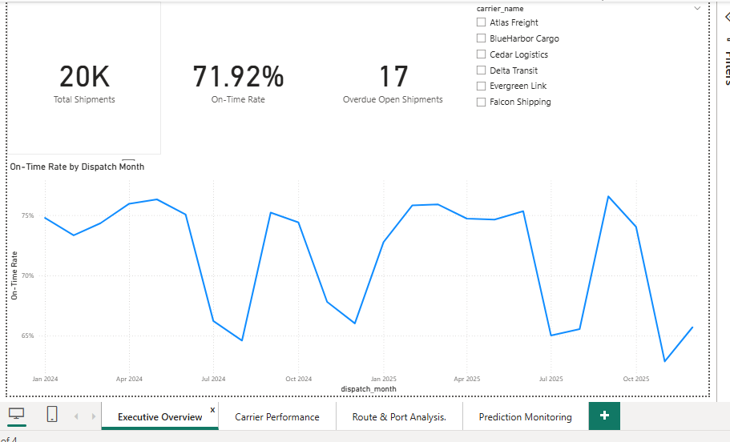
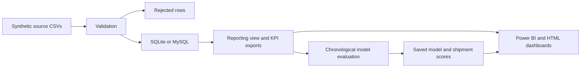
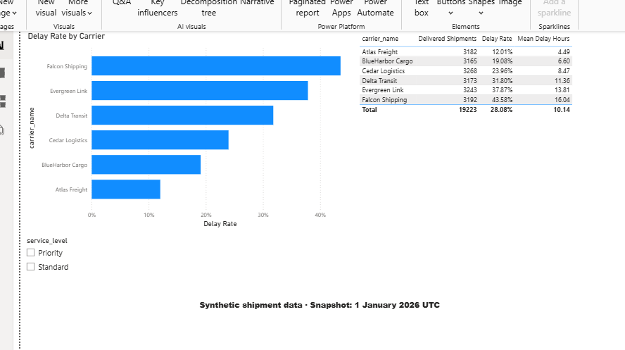
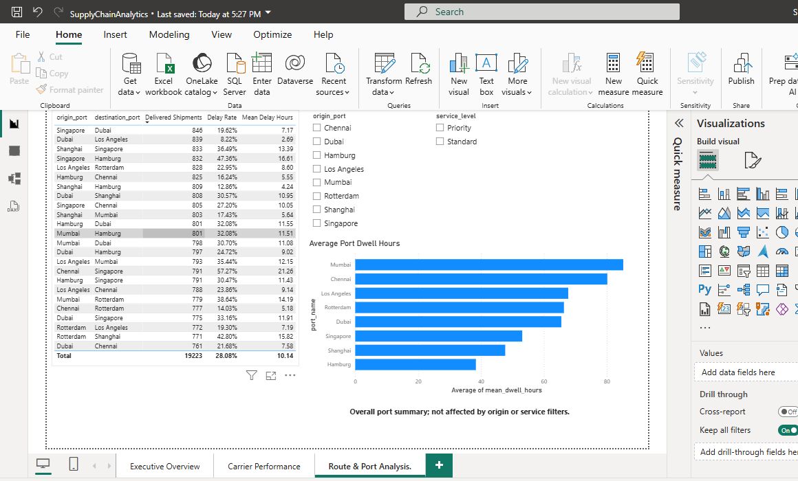
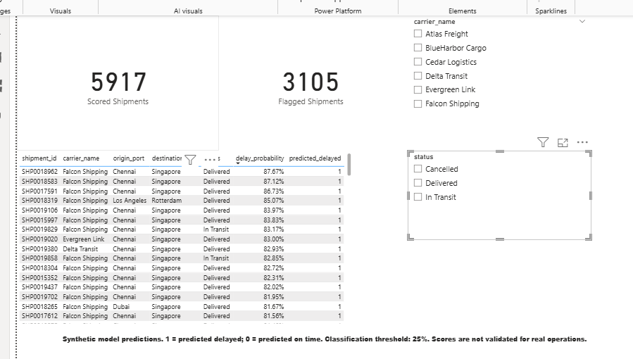

# Enterprise Supply Chain & Shipment Analytics

[](https://github.com/Ayushop-o0099/supply-chain-analytics/actions/workflows/tests.yml)

An end-to-end portfolio project that turns shipment records into operational KPIs, interactive dashboards, and dispatch-time delay predictions using **Python, SQL, MySQL, Pandas, NumPy, Scikit-learn, and Power BI**.

Explore **20,000 synthetic shipments**, six fictional carriers, 24 routes, eight ports, and 78,282 shipment events across 2024–2025. The project demonstrates data generation, validation, relational ETL, business analysis, machine learning, and reporting in one reproducible workflow.

The full pipeline runs locally using SQLite by default. The same SQLAlchemy schema and upsert workflow support MySQL. No real shipment data or business results are claimed.



## Highlights

- **Data quality:** quarantine 100 deliberately invalid shipment records with rejection reasons.
- **SQL analytics:** 15 business analyses, including CTEs, window functions, carrier rankings, and route performance.
- **Reliable ETL:** transactional upserts, relational constraints, and execution audit records.
- **Predictive modeling:** compare a baseline, logistic regression, and random forest with chronological, leakage-aware evaluation.
- **Reporting:** four Power BI pages plus an offline HTML dashboard with filters and CSV export.
- **Validation:** automated checks for data validation, database behavior, KPIs, temporal splits, and model inference.

## Snapshot results

| Metric | Synthetic snapshot |
|---|---:|
| Total shipments | 20,000 |
| Delivered shipments | 19,223 |
| On-time delivery rate | 71.92% |
| Overdue open shipments | 17 |
| Selected delay model | Logistic regression |
| Held-out test ROC-AUC | 0.7098 |
| Held-out test F1 | 0.5382 |

Snapshot cutoff: **1 January 2026 (UTC)**. Model results describe synthetic, completed shipments and do not establish real-world accuracy. See [model evaluation](reports/model_report.md) and [verification notes](reports/VERIFICATION.md).

## Start here

Use **Python 3.12** (the tested version) and Git. Power BI Desktop is optional and needed only for the native `.pbix` report; MySQL is optional.

In PowerShell:

```powershell
git clone https://github.com/Ayushop-o0099/supply-chain-analytics.git
cd supply-chain-analytics
python -m venv .venv
.\.venv\Scripts\python.exe -m pip install -r requirements.txt
.\.venv\Scripts\python.exe -m src.run_pipeline --generate --train
.\.venv\Scripts\python.exe -m pytest -q
```

On macOS/Linux, use `.venv/bin/python` instead of `.\.venv\Scripts\python.exe`. Training may take a few minutes. Synthetic CSVs and report snapshots are included; the virtual environment, local database, credentials, logs, and trained model are excluded from Git and created locally as needed. `requirements.txt` defines supported dependency ranges; `requirements-tested.txt` records the previous verification environment.

Open [powerbi/SupplyChainAnalyticsPolished.pbix](powerbi/SupplyChainAnalyticsPolished.pbix) in Power BI Desktop for the four-page report, including ML predictions. Open [reports/dashboard.html](reports/dashboard.html) locally in a browser for the additional offline report with carrier, origin, service and month filters and CSV download. GitHub displays the HTML source; download or clone the project to use the dashboard. Open [reports/eda.png](reports/eda.png) for the static chart overview.

## Architecture



## What the pipeline does

1. Generate reproducible source CSVs with a fixed seed and source hashes.
2. Validate types, keys, relationships, dates and statuses. Quarantine 100 intentional shipment errors.
3. Upsert dimension, shipment and event records transactionally with primary/foreign keys.
4. Create a shipment-level reporting view, calculate KPIs, export Power BI-ready CSVs and generate EDA findings.
5. Optionally compare a dummy baseline, logistic regression and random forest. Tune thresholds on validation data; evaluate the selected model once on test data.
6. Save the trained preprocessing/model pipeline and score post-training shipments.
7. Build an interactive HTML report. ETL execution records are stored in `etl_runs` and logs in `logs/pipeline.log`.

## Project map

| Path | Purpose |
|---|---|
| data/raw | Generated source CSVs and provenance manifest |
| data/processed | Clean shipment dataset, summaries, predictions and date dimension |
| data/rejected | Invalid input rows with rejection reasons |
| data/supply_chain.db | Local SQLite database, created on first run |
| src | Generator, ETL, analytics, model, scoring and report code |
| sql | MySQL schema, quality checks, 15 business analyses, reporting view |
| notebooks | Walkthrough EDA notebook |
| models | Saved Scikit-learn pipeline |
| reports | Interactive dashboard, chart, KPIs, EDA and model evaluation |
| powerbi | Power Query, DAX, theme and step-by-step report guide |
| tests | Validation, database, KPI, temporal split and inference checks |
| docs | Data dictionary and learning guide |

## MySQL setup

MySQL 8.0+ is required for the supplied CTE and window-function exercises. The MySQL service must be running and a user must have access to a dedicated project database.

1. In MySQL Workbench, execute `CREATE DATABASE IF NOT EXISTS supply_chain CHARACTER SET utf8mb4;` as a user allowed to create databases.
2. Copy `.env.example` to `.env` and set `DATABASE_URL` to your local connection URL. Use a dedicated project account and percent-encode password URL characters. Do not put credentials in Git.
3. Run `.\.venv\Scripts\python.exe -m src.run_pipeline --train` to load the existing CSVs into MySQL, analyze and score them. Python creates the tables, indexes and reporting view automatically.
4. Run the queries in `sql/02_quality_checks.sql` and `sql/03_analytics.sql` in Workbench.

Alternatively, `sql/01_schema.sql` shows the equivalent generated DDL for a fresh database. Run that script only once on a fresh schema because its standalone CREATE INDEX statements are not idempotent. Python's `metadata.create_all` handles normal repeated setup.

SQLite remains the default when DATABASE_URL is unset. The user has also successfully run ETL, analytics and model scoring against MySQL 8.0.42, with matching KPI results. Switching the URL does not migrate the SQLite database: ETL reloads the raw CSVs into the selected database.

## Routine commands

```powershell
# Refresh ETL and reports from existing raw data, without retraining
.\.venv\Scripts\python.exe -m src.run_pipeline

# Explicitly retrain and evaluate
.\.venv\Scripts\python.exe -m src.model

# Score new dispatch-time input rows
.\.venv\Scripts\python.exe -m src.predict data/sample_new_shipments.csv reports/new_predictions.csv

# Regenerate source data deterministically
.\.venv\Scripts\python.exe -m src.generate_data --rows 20000 --seed 42
```

For scheduled refresh, use Windows Task Scheduler to run the venv Python executable with arguments `-m src.run_pipeline`, with this project folder in “Start in”. This project does not create a scheduled task automatically.

Upserts update existing IDs and insert new IDs. They intentionally do not delete rows absent from new source files. Use a fresh database URL when changing the generator's row count/seed for a new experiment; otherwise older records and model versions remain. The prediction CSV export contains only the current model. Routine refresh does not rescore new rows; run training or the separate prediction command explicitly as appropriate. Reports show the fixed dataset snapshot, not today's operational state.

## Modeling rules

Prediction time is dispatch. Features: carrier, route, service, weight, distance, planned transit hours, dispatch month and weekday. Actual delivery, final status, delay duration and later events are excluded.

Splits follow dispatch order (~70/15/15). Training deliveries must complete before validation begins; validation deliveries must complete before testing begins. Fitting preprocessing happens inside each candidate pipeline using training rows only. Model/threshold selection uses validation F1; held-out test metrics are reported separately. The selected model is saved without refitting on the test set.

Read `reports/model_report.md` for measured results. Scores are based on a stochastic synthetic generator, are not calibrated, and do not establish real-world accuracy. Completed-only evaluation has censoring near the snapshot cutoff.

## Power BI

The native report is saved as **powerbi/SupplyChainAnalyticsPolished.pbix**. Its four pages are Executive Overview, Carrier Performance, Route & Port Analysis, and Prediction Monitoring. Screenshots document KPI totals and carrier/status filtering from the report-building workflow. See [verification notes](reports/VERIFICATION.md) for evidence and limitations.

The report imports the Python-generated CSVs, not a live MySQL connection. Refresh the Python exports first, then use Refresh in Power BI and save the PBIX. When moving to another computer, update the CSV source paths in Power Query. `powerbi/BUILD_GUIDE.md` remains a reference for rebuilding the report.

Shipments filters Predictions through shipment_id, with a single-direction one-to-many relationship. PortDwell is a separate all-visits summary and is intentionally unaffected by shipment slicers. Model scores cover 5,917 post-training shipments; 3,105 are flagged at the 25% threshold. Filtering to In Transit shows 485 scored and 279 flagged shipments. These are retrospective synthetic scores, not live operational forecasts.

### Dashboard screenshots





## Learning path

Read `docs/STEP_BY_STEP.md`, then inspect source files in pipeline order. See `docs/DATA_DICTIONARY.md` for units, grain, synthetic assumptions and KPI definitions. Do not join shipment-level cost to multiple event rows without aggregating events first.

## References

- MySQL CTEs: https://dev.mysql.com/doc/refman/8.0/en/with.html
- MySQL window functions: https://dev.mysql.com/doc/refman/8.0/en/window-functions.html
- Scikit-learn leakage guidance: https://scikit-learn.org/stable/common_pitfalls.html
- Power BI MySQL connector: https://learn.microsoft.com/en-us/power-query/connectors/mysql-database
